<picture><source media="(prefers-color-scheme: dark)" srcset="assets/profile/hero-dark.svg"></picture>

<a href="https://letsgolighthouse.co.in"><picture><source media="(prefers-color-scheme: dark)" srcset="assets/profile/tile-lighthouse-dark.svg"></picture></a><a href="https://github.com/pixar634/prepster"><picture><source media="(prefers-color-scheme: dark)" srcset="assets/profile/tile-prepster-dark.svg"></picture></a><a href="https://github.com/pixar634/jobmagnet"><picture><source media="(prefers-color-scheme: dark)" srcset="assets/profile/tile-jobmagnet-dark.svg"></picture></a><picture><source media="(prefers-color-scheme: dark)" srcset="assets/profile/tile-private-dark.svg"></picture>

<a href="https://letsgolighthouse.co.in">letsgolighthouse.co.in</a> &nbsp;·&nbsp; set in Nohemi by Rajesh Rajput

